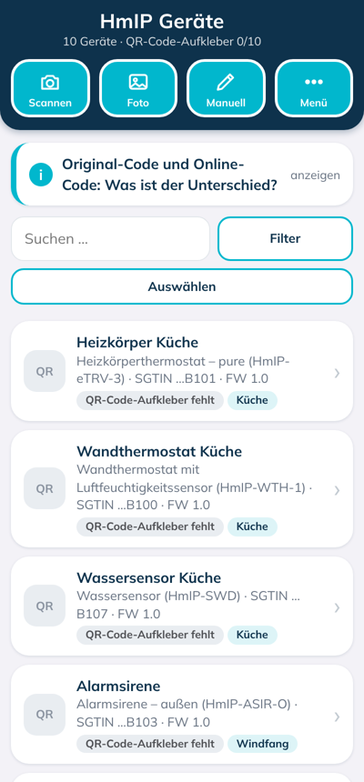
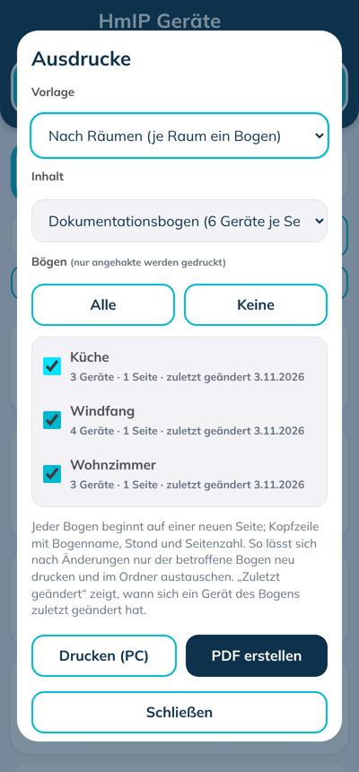
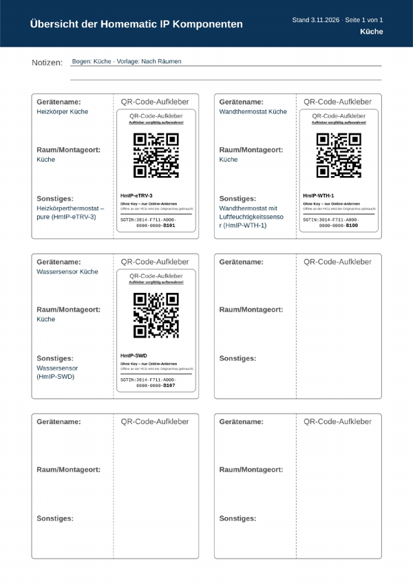

# HmIP Geräteverwaltung – Plugin für die Homematic IP Home Control Unit


Dieses Plugin dokumentiert alle Homematic-IP-Geräte deiner Installation –
mitsamt den **QR-Code-Aufklebern**, die jedem Gerät beiliegen und die man
spätestens beim Neuanlernen oder Offline-Anlernen wieder braucht:

- **Geräteliste automatisch aus der HCU**: Name, Typ (mit Produktbezeichnung),
  Raum, Firmware und Seriennummer (SGTIN)
- **Original-Aufkleber scannen** – live mit der Handy-Kamera oder per Foto.
  Der Code wird dem passenden Gerät zugeordnet, der Geräteschlüssel (Key)
  wird gespeichert.
- **Dokumentationsbogen drucken**: Nachbau des Homematic-IP-Vordrucks mit
  Gerätename, Raum/Montageort, Sonstiges und einem neu erzeugten
  QR-Code-Aufkleber – aufgeteilt nach Räumen, nach Funktion oder alphabetisch,
  jeder Bogen einzeln austauschbar
- **Änderungen im Blick**: neu angelernte Geräte kommen von selbst dazu,
  umbenannte, verschobene und entfernte Geräte werden markiert

Alles läuft in einer eigenen Weboberfläche des Plugins, die auf dem Handy
genauso funktioniert wie am PC.

<p>


</p>

> **Wichtig vorab**
>
> - Das ist **kein offizielles Produkt von eQ-3** und wird ohne jede
>   Gewähr bereitgestellt (siehe [LICENSE](LICENSE)).
> - Eigene Plugins lassen sich nur installieren, wenn auf der HCU der
>   **Entwicklermodus** aktiv ist. Laut eQ-3 gibt es für Geräte mit
>   aktiviertem Entwicklermodus **keinen technischen Support**, und der
>   Entwicklermodus lässt sich nur über einen Werksreset oder das
>   Einspielen einer Sicherung wieder verlassen. **Vorher eine Sicherung
>   der HCU anlegen.**
> - Das Plugin speichert die **Geräteschlüssel** deiner Geräte. Die
>   Weboberfläche ist deshalb mit einem Passwort geschützt, und Ausdrucke
>   und Backups mit Original-Codes gehören sicher verwahrt.

## Was das Plugin kann

- **Geräte übernehmen**: Beim Start und bei jedem neu angelernten,
  entfernten oder umbenannten Gerät gleicht das Plugin die Liste mit der
  HCU ab (über die Ereignisse der Connect API). Eigene Eingaben wie
  Einbauort und Notiz bleiben dabei erhalten.
- **Scannen**: Live-Scan mit der Kamera (über HTTPS, siehe unten) oder
  Auslesen eines Fotos. Die Erkennung läuft im Browser; Fotos werden nicht
  gespeichert.
- **Original-Code und Online-Code**:
  - *Original-Code (mit Key)* – der gescannte Code des beiliegenden
    Aufklebers. Reicht für jedes Anlernen, auch **offline an der HCU**
    (laut Homematic-IP-Anwenderhandbuch wird dafür der „Local Key“ vom
    beiliegenden Aufkleber gebraucht).
  - *Online-Code (ohne Key)* – für Geräte, deren Aufkleber noch nicht
    gescannt ist, erzeugt das Plugin einen Aufkleber nur aus der
    Seriennummer. Er reicht für das **normale Anlernen mit Internet** (dort
    genügen laut Handbuch auch die letzten vier Ziffern der SGTIN) und ist
    entsprechend gekennzeichnet. Den Key selbst gibt die HCU nicht heraus.
- **Ausdrucke** als PDF (auf dem Handy teilen/speichern) oder direkt am PC:
  - Vorlagen: **nach Räumen**, **nach Funktion** (Kategorien wie auf
    homematic-ip.com; ein Gerät erscheint in allen seinen Kategorien),
    **alphabetisch** oder nach **aktuellem Filter/Auswahl**
  - Inhalt: Dokumentationsbogen (6 Geräte je A4-Seite) oder nur
    QR-Code-Aufkleber
  - Jeder Bogen beginnt auf einer neuen Seite und trägt Bogenname, Stand und
    Seitenzahl. Je Bogen wird angezeigt, wann sich zuletzt eines seiner
    Geräte geändert hat – so druckst du nur nach, was sich geändert hat, und
    tauschst die Seiten im Ordner aus.
- **Filter**: mehrere Räume, Kategorien und Gerätetypen gleichzeitig,
  Aufkleber erfasst/fehlt, „in der HCU geändert“, „nicht mehr in der HCU“,
  Suche, Handauswahl
- **Änderungen übernehmen**: Wurde ein Gerät in der HCU umbenannt oder in
  einen anderen Raum verschoben, zeigt das Plugin den neuen Wert an –
  einzeln übernehmen, beibehalten oder alle auf einmal übernehmen.
- **Export**: CSV für Excel (ohne Schlüssel), Backup als JSON (mit
  Schlüsseln), Backup importieren
- **Anleitung** und **Versionsnummer** im Menü



## Voraussetzungen

- Homematic IP **Home Control Unit (HCU)**, Firmware 1.4.7 oder neuer
- **Entwicklermodus** auf der HCU aktiv (wird in HCUweb eingeschaltet)
- Ein aktueller Browser auf Handy oder PC im selben Netz wie die HCU

## Installation

1. Unter [Releases](../../releases) die neueste Datei
   `hmip-geraeteverwaltung-<version>.tar.gz` herunterladen. **Nicht entpacken.**
2. HCUweb im Browser öffnen, zur **Plugin-Seite** gehen und die Datei
   hochladen. Die Installation startet automatisch.
3. Auf der Einstellungsseite des Plugins in HCUweb stehen **„Weboberfläche
   öffnen“**, die Adresse zum Kopieren und ein **QR-Code** zum Öffnen mit dem
   Handy. Die Oberfläche ist unter `https://<IP-Adresse-der-HCU>:8443`
   erreichbar – **https**, nicht http.
4. Beim ersten Aufruf zeigt der Browser eine **Zertifikatswarnung** (siehe
   unten). Einmal bestätigen.
5. Ein **Passwort** (mindestens 8 Zeichen) festlegen. Fertig – die Geräte
   erscheinen nach wenigen Sekunden.

## Bedienung in Kürze

1. **Scannen** antippen und den Original-Aufkleber eines Geräts in die
   Kamera halten (oder **Foto** wählen). Das Gerät wird erkannt und der Key
   gespeichert.
2. Gerät antippen, **Einbauort** und **Notiz** ergänzen, speichern.
3. **Menü → Ausdrucke erstellen**: Vorlage wählen, Bögen anhaken, PDF
   erstellen oder drucken.

Die ausführliche Anleitung steht im Plugin unter **Menü → Anleitung**.

## Warum HTTPS und eine Zertifikatswarnung?

Browser geben die Kamera nur auf HTTPS-Seiten frei. Das Plugin erzeugt
deshalb beim ersten Start ein eigenes (selbstsigniertes) Zertifikat. Weil
es von keiner Zertifizierungsstelle stammt, warnt der Browser einmalig;
nach dem Bestätigen funktioniert der Live-Scan. Klappt er auf einem Gerät
trotzdem nicht, funktioniert **Foto** immer.

## Passwort

- **Ändern**: Menü → „Passwort ändern“
- **Abmelden**: Menü → „Abmelden“
- **Vergessen**: In HCUweb die Einstellungen des Plugins öffnen,
  **„Passwort der Weboberfläche zurücksetzen“** einschalten und speichern.
  Beim nächsten Aufruf ein neues Passwort festlegen. Die Gerätedaten bleiben
  erhalten.

Nach 5 falschen Versuchen wird die Anmeldung kurz gesperrt.

## Updates

Neue Version herunterladen und in HCUweb genauso hochladen. Die Daten liegen
im dauerhaften Speicher des Plugins (`/data`) und bleiben erhalten. Vor einem
Update empfiehlt sich trotzdem ein **Backup (JSON)** aus dem Menü.

## Sicherheit und Datenschutz

- Die Gerätedaten inklusive Geräteschlüsseln liegen nur auf deiner HCU
  (`/data/devices.json`). Das Passwort wird als scrypt-Hash gespeichert.
- Das Plugin arbeitet nur im lokalen Netz und braucht keinen
  Internetzugang.
- Ausdrucke mit Original-Codes, JSON-Backups und der Ordner mit den Bögen
  enthalten die Schlüssel – wie die Original-Aufkleber sicher aufbewahren.
  Die CSV-Datei enthält keine Schlüssel.

## Bekannte Grenzen

- **Gerätebezeichnungen und Kategorien** sind eine eingebaute Liste
  (Quellen: Download-Bereich und Produktfilter von homematic-ip.com, Stand
  02.11.2026). Unbekannte Gerätetypen werden mit ihrem Kürzel und unter
  „(ohne Kategorie)“ angezeigt. Ergänzungen gern per [Issue](../../issues).
- **Online-Code**: Dass die Homematic-IP-App einen QR-Code im Format
  `EQ01SG<SGTIN>` (ohne Key) beim Anlernen erkennt, ist nicht dokumentiert,
  sondern ausprobiert. Die SGTIN allein lehnt die App ab.
- Die Connect API ist laut eQ-3 noch ein **Entwurf** (Doku 1.0.1); Änderungen
  durch HCU-Updates sind möglich.
- Der klickbare Link auf der HCUweb-Einstellungsseite nutzt den Feldtyp
  `WEBLINK`, der nicht in der Connect-API-Dokumentation steht. Fällt er weg,
  bleiben Adresse und QR-Code.
- Getestet mit einer HCU und rund 80 Geräten. Rückmeldungen über
  [Issues](../../issues) sind willkommen.

## Auch für Home Assistant

Die gleiche Oberfläche gibt es als Home-Assistant-Integration (HACS):
[OllO18/hmip-geraete-ha](https://github.com/OllO18/hmip-geraete-ha).

## Für Entwickler

```
npm ci
npm test
DATA_DIR=./data WEB_PORT=18443 node plugin.js de.ollo18.hmip.geraeteverwaltung hcu1-XXXX.local token.txt
```

Ohne erreichbare HCU startet die Oberfläche trotzdem; nur der Abgleich meldet
dann „Keine Verbindung zur HCU“. Das Installationspaket baut die GitHub-Action
„Plugin bauen“ (ARM64-Image als `.tar.gz`); beim Veröffentlichen eines
Releases `v<version>` wird es automatisch angehängt.

## Lizenzen

- Plugin: MIT
- qrcode-generator (Kazuhiko Arase): MIT, `www/qrcode.mjs`
- jsQR (Cosmo Wolfe): Apache-2.0, `www/jsqr.mjs`, Lizenz in `www/LICENSE-jsQR.txt`
- Schrift Mulish: SIL Open Font License, `www/fonts/OFL-Mulish.txt`

Homematic IP ist eine Marke der eQ-3 AG. Dieses Projekt steht in keiner
Verbindung zur eQ-3 AG.
